# Terraform Lab — AWS Infrastructure as Code

Provision foundational AWS infrastructure with Terraform, storing state remotely in **S3** with **DynamoDB** state locking.

## Architecture

| Resource | Purpose |
|---|---|
| VPC | Isolated network for the lab |
| Public subnet | Hosts the EC2 instance |
| Internet Gateway + route | Gives the subnet internet access |
| Security group | SSH (22) from my IP, HTTP (80) from anywhere |
| EC2 (t2.micro) | Compute instance running nginx |
| S3 + DynamoDB | Remote state storage and locking |

## Project Structure

```
├── bootstrap/     # Creates the S3 bucket + DynamoDB table (local state)
├── backend.tf     # S3 remote backend with DynamoDB locking
├── main.tf        # Provider and resources
├── variables.tf   # Input variables
├── outputs.tf     # Output values
├── example.tfvars # Sample variable values
└── screenshots/   # Verification screenshots
```

## Prerequisites

- Terraform >= 1.5
- AWS CLI configured (`aws configure`)

## Usage

```bash
# 1. Create the backend (once)
terraform -chdir=bootstrap init
terraform -chdir=bootstrap apply

# 2. Deploy the infrastructure
cp example.tfvars terraform.tfvars   # then set my_ip and key_name
terraform init
terraform plan
terraform apply
terraform destroy
```

---

## Build Log

### 1. VPC

Creates a VPC (`10.0.0.0/16` by default) with DNS support and DNS hostnames enabled, so instances launched inside it get resolvable public DNS names. Every resource is tagged with `Project` and `ManagedBy` via the provider's `default_tags`.

- **Variables:** `aws_region`, `project_name`, `vpc_cidr`
- **Outputs:** `vpc_id`, `vpc_cidr`

### 2. Public Subnet

Creates a `/24` subnet (`10.0.1.0/24` by default) inside the VPC, placed in the region's first available AZ (looked up dynamically, not hard-coded). `map_public_ip_on_launch` gives instances a public IP automatically. It becomes truly *public* once the Internet Gateway route is attached in the next step.

- **Variables:** `public_subnet_cidr`
- **Outputs:** `public_subnet_id`, `public_subnet_az`

### 3. Internet Gateway and Route

Attaches an Internet Gateway to the VPC and creates a public route table with a default route (`0.0.0.0/0`) pointing to it. The route table is associated with the public subnet, which is what actually makes the subnet public.

- **Outputs:** `internet_gateway_id`, `public_route_table_id`

### 4. Security Group

Creates a security group in the VPC with three rules:

| Direction | Port | Source | Purpose |
|---|---|---|---|
| Inbound | 22 (TCP) | `my_ip` | SSH, restricted to your IP |
| Inbound | 80 (TCP) | `0.0.0.0/0` | HTTP from anywhere |
| Outbound | All | `0.0.0.0/0` | Updates and package installs |

`my_ip` has no default and is validated as a CIDR. Set it in `terraform.tfvars` (git-ignored) so your IP is never committed.

- **Variables:** `my_ip`
- **Outputs:** `security_group_id`

### 5. EC2 Instance

Launches a `t2.micro` instance in the public subnet with the security group attached. The AMI is the latest Amazon Linux 2023, looked up at plan time. On first boot, a user-data script installs and starts **nginx**, so port 80 can be tested from a browser.

Hardening defaults: IMDSv2 required and an encrypted 8 GB `gp3` root volume.

- **Variables:** `instance_type`, `key_name` (an existing key pair, used for SSH)
- **Outputs:** `instance_id`, `instance_public_ip`, `web_url`

Verify:

```bash
curl $(terraform output -raw web_url)
ssh -i ~/.ssh/terraform-lab-key.pem ec2-user@$(terraform output -raw instance_public_ip)
```

### 6. Remote Backend (S3 + DynamoDB)

A backend can't create its own bucket, so the `bootstrap/` module creates it first, using local state:

- **S3 bucket** `terraform-lab-state-<account-id>`: stores the state file, with versioning (state history), AES-256 encryption and all public access blocked.
- **DynamoDB table** `terraform-lab-lock`: partition key `LockID`, on-demand billing. Terraform writes a lock item here during `plan`/`apply` so two runs can't change the state at once.

`backend.tf` points the root module at them. The existing local state was moved into S3 with:

```bash
terraform init -migrate-state
```

Terraform warns that `dynamodb_table` is deprecated in favor of S3-native locking (`use_lockfile`). DynamoDB is kept because this lab requires it.

Verify:

```bash
aws s3 ls s3://terraform-lab-state-<account-id>/terraform-lab/
aws dynamodb scan --table-name terraform-lab-lock
```

---

## Screenshots

### `terraform plan`

**Plan (1/8)**

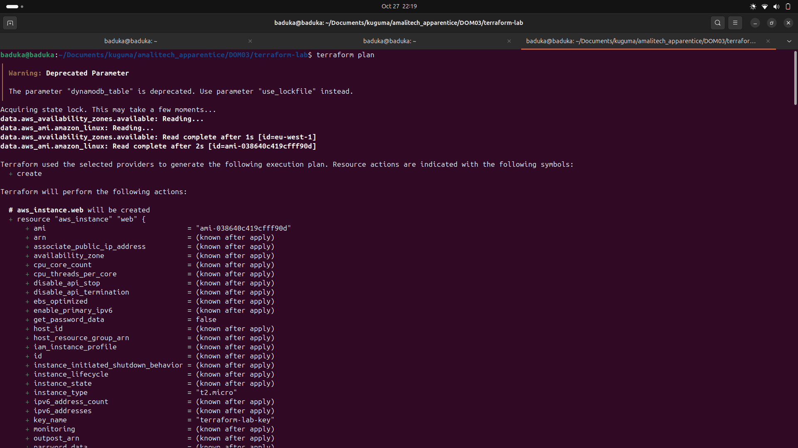

**Plan (2/8)**

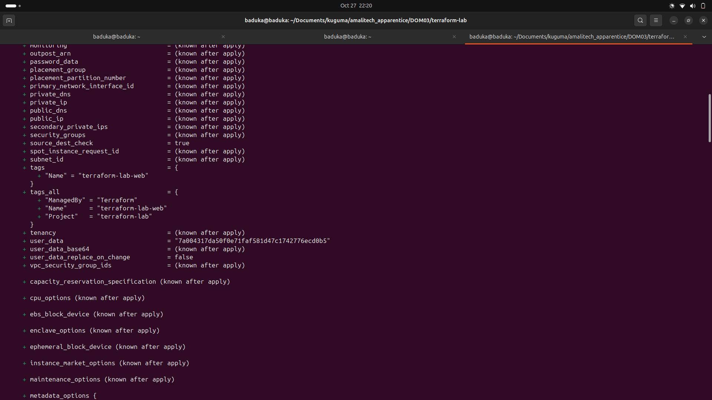

**Plan (3/8)**

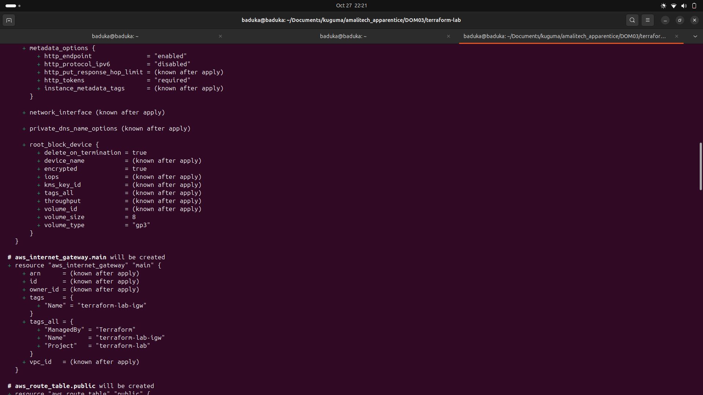

**Plan (4/8)**

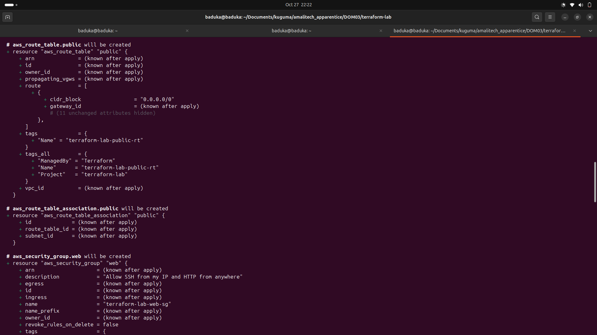

**Plan (5/8)**

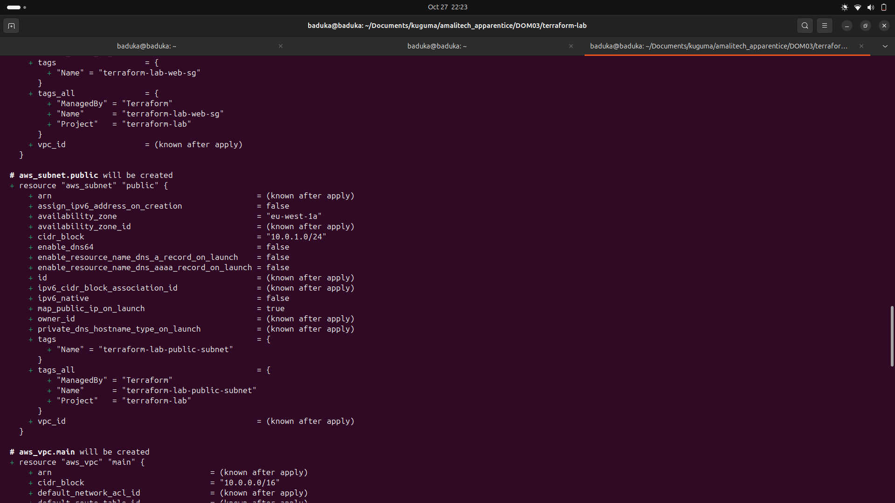

**Plan (6/8)**

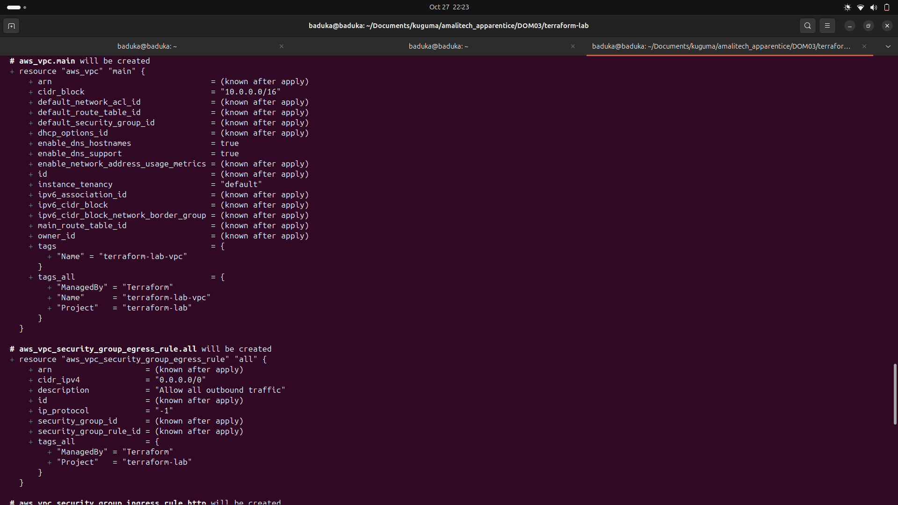

**Plan (7/8)**

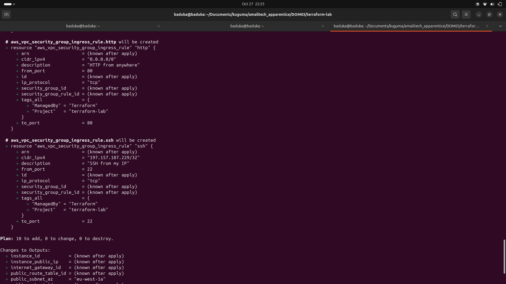

**Plan (8/8)**

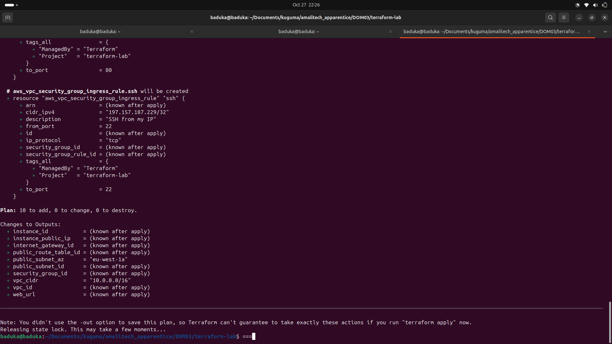

### `terraform apply`

**Apply**

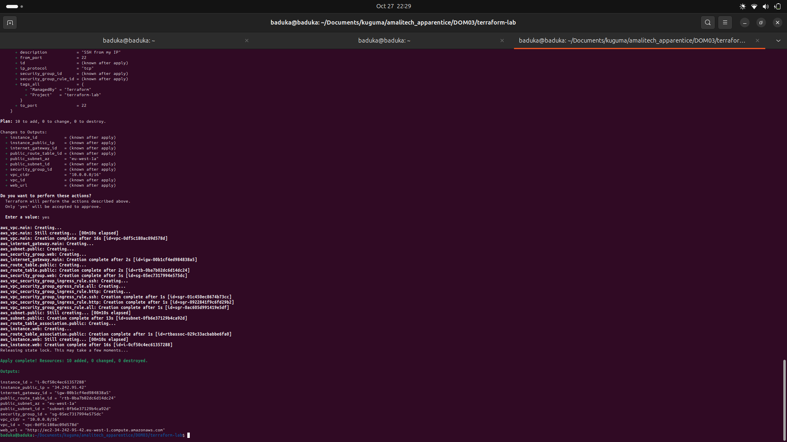

### Verification

**EC2 instance running (t2.micro)**

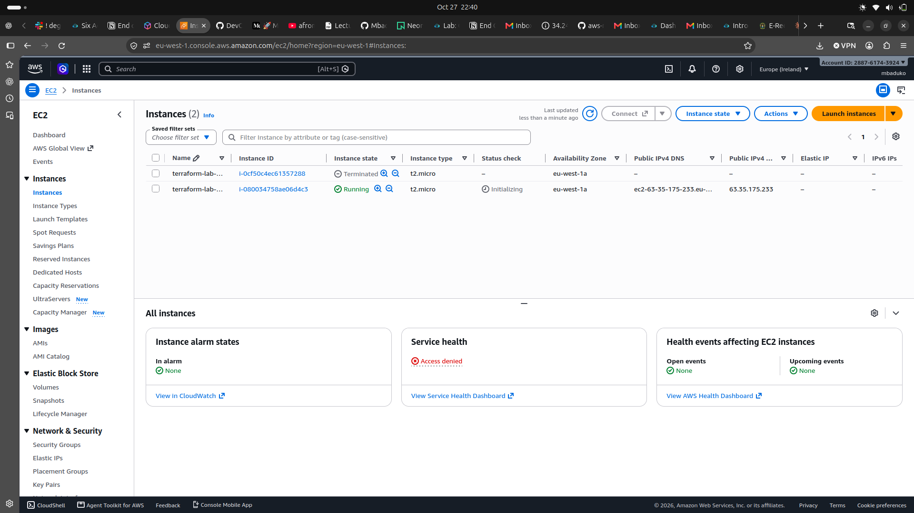

**State file in S3**

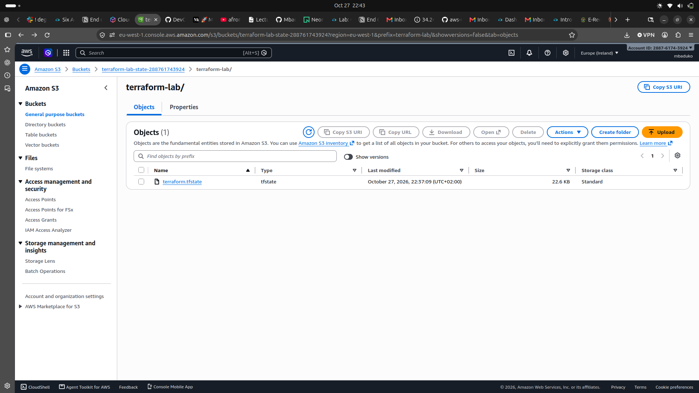

**State file versions**

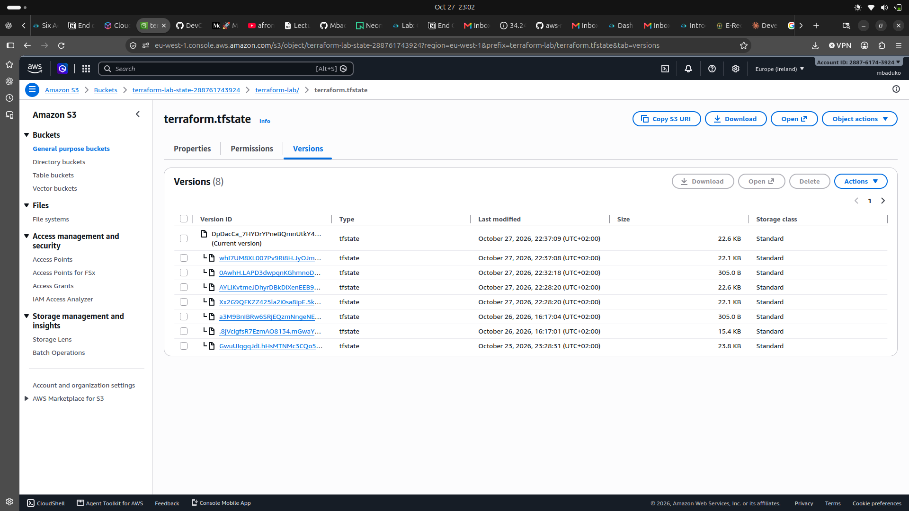

**DynamoDB lock table**

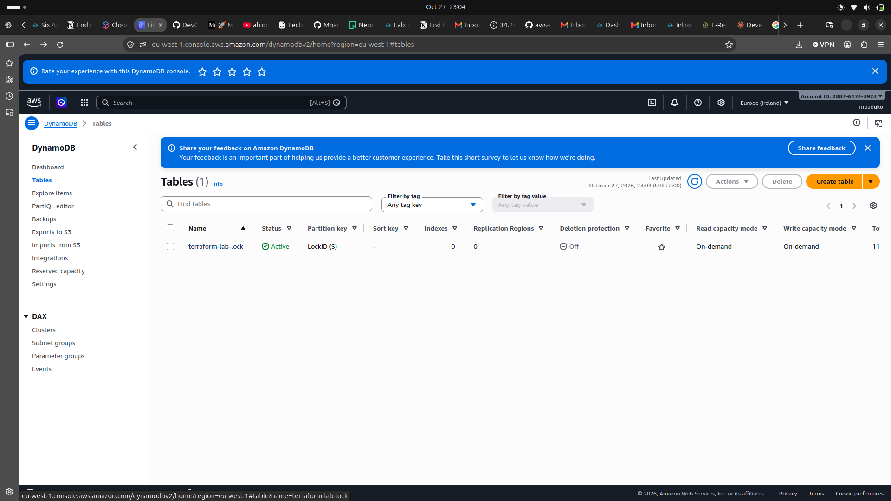

### `terraform destroy`

**Destroy (1/2)**

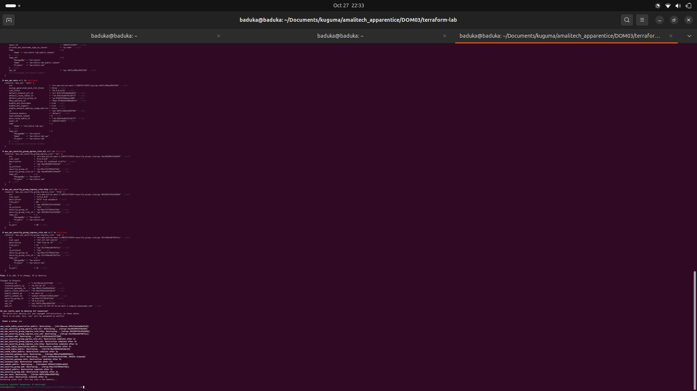

**Destroy (2/2) — 10 resources destroyed**

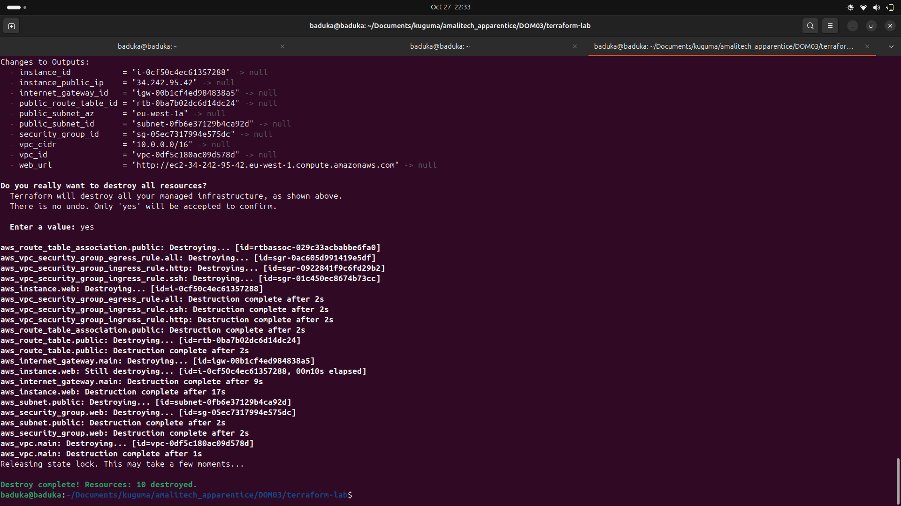
